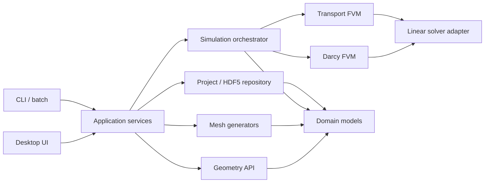

# Проект программы двумерной фильтрации и переноса

Статус документа: реализованная базовая версия и направления расширения.

## 1. Цель и границы первой версии

Программа рассчитывает нестационарное двухфазное вытеснение вязких несжимаемых
жидкостей в двумерном пористом пласте. Неизвестными являются давление и
насыщенность смачивающей фазы. Подвижности фаз определяются вязкостями и
степенными функциями относительных фазовых проницаемостей.

Первая версия должна уметь:

1. создавать параметрическую область «ячейка пятиточечной системы» — прямоугольник
   с двумя четвертями круговых скважин в противоположных углах;
2. строить для неё структурированную четырёхугольную сетку, согласованную с
   линиями тока и изобарами и сгущённую у скважин;
3. решать уравнение Дарси и закон сохранения массы;
4. решать консервативное уравнение переноса насыщенности;
5. задавать физические параметры, граничные условия и численные настройки;
6. показывать геометрию, сетку, давление и насыщенность, а также временные
   функции дебита жидкости и обводнённости добывающей скважины;
7. сохранять проект, расчётную сетку, результаты и журнал расчёта.

Для добывающей скважины сохраняются

\[
Q_{liq}^{prod}(t)=\sum_{f\in\Gamma_{prod}}Q_{t,f},\qquad
Q_w^{prod}(t)=\sum_{f\in\Gamma_{prod}}Q_{w,f},\qquad
WCT^{prod}(t)=\frac{Q_w^{prod}(t)}{Q_{liq}^{prod}(t)}.
\]

Именно `WCT` добывающей скважины является основным показателем обводнения;
доля воды на нагнетателе сохраняется лишь как диагностическая проверка
заданного состава закачки.

Редактор произвольной расчётной области не входит в первую версию, но модель
геометрии и интерфейс генератора сетки сразу проектируются расширяемыми.

## 2. Принятые физические допущения

### 2.1. Двухфазная фильтрация

Для жёсткого пористого скелета и двух несмешивающихся несжимаемых фаз
\(\alpha\in\{w,o\}\):

\[
\mathbf u_\alpha=-\mathbf K\lambda_\alpha
\left(\nabla p_\alpha-\rho_\alpha\mathbf g\right),
\qquad
\lambda_\alpha=\frac{k_{r\alpha}}{\mu_\alpha},
\qquad S_w+S_o=1.
\]

Здесь \(\mathbf u_\alpha\) — скорость Дарси фазы, \(\mathbf K\) — абсолютная
проницаемость, \(k_{r\alpha}\) — относительная фазовая проницаемость,
\(\mu_\alpha\) — динамическая вязкость. Для двумерной модели расходы умножаются
на толщину пласта \(h\).

В первой версии капиллярное давление и гравитация отключены, поэтому
\(p_w=p_o=p\). Полная подвижность
\(\lambda_t=\lambda_w+\lambda_o\) зависит от насыщенности. Следовательно,
давление необходимо пересчитывать на каждом шаге времени, а не только один раз.

### 2.2. Степенные относительные фазовые проницаемости

Нормированная эффективная водонасыщенность:

\[
S_e=\operatorname{clip}\left(
\frac{S_w-S_{wc}}{1-S_{wc}-S_{or}},0,1\right).
\]

Степенные зависимости задаются как:

\[
k_{rw}(S_w)=k_{rw}^{end}S_e^{n_w},
\qquad
k_{ro}(S_w)=k_{ro}^{end}(1-S_e)^{n_o}.
\]

Обязательные параметры: связанная водонасыщенность \(S_{wc}\), остаточная
нефтенасыщенность \(S_{or}\), концевые значения \(k_{rw}^{end}\),
\(k_{ro}^{end}\) и положительные показатели \(n_w\), \(n_o\). Проверяется
\(0\le S_{wc}<1\), \(0\le S_{or}<1\), \(S_{wc}+S_{or}<1\),
\(0<k_r^{end}\le1\), \(n_w,n_o>0\).

### 2.3. Уравнение насыщенности

При нулевых капиллярных и гравитационных силах:

\[
\nabla\cdot\mathbf u_t=q_t, \qquad
\mathbf u_t=-\mathbf K\lambda_t(S_w)\nabla p,
\]

\[
\phi\frac{\partial S_w}{\partial t}
+\nabla\cdot\left(f_w(S_w)\mathbf u_t\right)=q_w,
\qquad
f_w=\frac{\lambda_w}{\lambda_t}.
\]

Реализованы два переключаемых варианта. В явном IMPES давление и полный поток
вычисляются по насыщенности предыдущего слоя, после чего насыщенность
обновляется с ограничением CFL. В последовательном неявном варианте давление
также фиксируется на временном шаге, а уравнение переноса интегрируется методом
Backward Euler. Нелинейная система решается Newton–BiCGSTAB. Полностью связанная
неявная схема давления и насыщенности остаётся расширением.

## 3. Две сопоставляемые постановки пятиточечной задачи

### 3.1. Гидродинамическая сетка и конечные границы скважин

Область задаётся прямоугольником \([0,L_x]\times[0,L_y]\). Центры двух скважин
лежат **точно в противоположных вершинах** прямоугольника:

\[
\mathbf x_{inj}=(0,0), \qquad \mathbf x_{prod}=(L_x,L_y).
\]

Из прямоугольника исключаются части дисков скважин, попавшие внутрь ячейки:

\[
\Omega=[0,L_x]\times[0,L_y]
\setminus\left(B_{r_{inj}}(\mathbf x_{inj})\cup
B_{r_{prod}}(\mathbf x_{prod})\right).
\]

Поэтому внутри одной ячейки видна ровно четверть окружности каждой скважины, а
не «скруглённый угол» с центром дуги внутри пласта. Две остальные вершины
прямоугольника остаются обычными прямыми углами. При зеркальном продолжении
ячейки относительно её внешних сторон четверти объединяются в полные скважины и
восстанавливается шахматная пятиточечная расстановка. Это ячейка симметрии;
простое трансляционное копирование без отражения дало бы противоречащие типы
скважин в общих вершинах.

Дуги исключённых дисков являются внутренними по отношению к прямоугольнику
границами скважин, а оставшиеся прямые стороны — границами симметрии.

Обязательные именованные группы границ:

- `well_injector` — дуга нагнетательной скважины;
- `well_producer` — дуга добывающей скважины;
- `symmetry_path_a`, `symmetry_path_b` — два внешних пути от одной скважины к
  другой; физически на них действует условие непроницаемости;
- дополнительные имена будут добавляться редактором геометрии в будущем.

Рекомендуемый сценарий по умолчанию:

- на `well_injector`: \(p=p_{inj}\), состав притока задаётся долей воды
  \(f_w^{inj}=1\);
- на `well_producer`: \(p=p_{prod}\), фазовый состав выходящего потока
  определяется внутренней насыщенностью;
- на внешней границе: \(\mathbf u_t\cdot\mathbf n=0\), то есть потоки обеих
  фаз через границу отсутствуют.

Нужно также поддержать задание расхода на скважине. При полностью расходных
условиях проверяется совместность суммарного притока и отбора, а давление
фиксируется дополнительным условием калибровки.

### 3.2. Равномерная сетка и точечные угловые скважины

Во второй постановке областью является весь прямоугольник без вырезов:

\[
\Omega_u=[0,L_x]\times[0,L_y].
\]

Все четыре внешние стороны непроницаемы. Скважины представлены объёмными
источниками в ячейках \((0,0)\) и \((N_x-1,N_y-1)\). Поскольку расчётная область
является ячейкой симметрии, каждая угловая скважина имеет секторный угол
\(\theta=\pi/2\), то есть даёт четверть дебита полной скважины.

Для управления по давлению используется

\[
q_w=WI_{1/4}(p_w-p_c),\qquad
WI_{1/4}=
\frac{(\pi/2)h\sqrt{k_xk_y}\lambda_t}
{\ln(r_e/r_w)+s}.
\]

Чтобы получить \(r_e\), угловая ячейка \(\Delta x\times\Delta y\) отражается
относительно двух непроницаемых сторон. Формула Писмена применяется к
полученной центральной ячейке \(2\Delta x\times2\Delta y\):

\[
r_e=0.28\,
\frac{\sqrt{\sqrt{k_y/k_x}(2\Delta x)^2+
                   \sqrt{k_x/k_y}(2\Delta y)^2}}
{(k_y/k_x)^{1/4}+(k_x/k_y)^{1/4}}.
\]

Для изотропной квадратной сетки \(r_e=0.28\sqrt2\,\Delta\). В балансе
нагнетательной ячейки источник положителен, в балансе добывающей — отрицателен.
Водяная доля нагнетателя задаётся входным условием, а вода в продукции
вычисляется по дробному потоку угловой добывающей ячейки.

Исходная формула Писмена доступна как контрольный режим
`well_model.corner_correction = "none"`. Для квадратной однородной изотропной
пятиточки реализована поправка `"muskat"`. При подготовке задачи сначала
решается линейная задача с исходными индексами и определяется полное
сопротивление \(R_h=\Delta p/Q_h\). Эталонное сопротивление вычисляется из
формулы Маскета для четверти элемента:

\[
Q_M=\frac{\pi kh\lambda_t}{4}
\frac{\Delta p}{\ln(\sqrt2L/r_w)-0.6188},
\qquad R_M=\frac{\Delta p}{Q_M}.
\]

Положительная разность \(\Delta R=R_M-R_h\) делится поровну между двумя
скважинами:

\[
\frac1{WI_w^{\mathrm{corr}}}=
\frac1{WI_w^{\mathrm{P}}}+\frac{\Delta R}{2}.
\]

На практике добавочное сопротивление переводится в безразмерный угловой скин
и затем остаётся постоянным на всём двухфазном расчёте. Поэтому фазовая
подвижность продолжает входить в индекс обычным способом, а дебит не
перемасштабируется и не подгоняется на временных шагах.

## 4. Дискретизация методом конечных объёмов

### 4.1. Размещение величин

- давление и водонасыщенность — в центрах ячеек;
- геометрические метрики — для ячеек и граней;
- нормальный объёмный расход — на гранях;
- полная и фазовые скорости в центре ячейки — реконструированные поля для
  визуализации;
- именно гранные расходы, а не интерполированные скорости, используются в
  уравнении переноса, чтобы сохранить локальный баланс массы.

### 4.2. Давление

Для каждой ячейки интегрируется \(\nabla\cdot\mathbf u_t=q_t\). Нормальный поток
через внутреннюю грань вычисляется через гармонически усреднённую нормальную
полную проводимость \(\mathbf K\lambda_t(S_w)\). На ортогональной или почти
ортогональной сетке основной член соответствует двухточечной аппроксимации.
Реализованная базовая версия использует этот член; итерационная
неортогональная поправка оставлена для следующей версии.

Для рабочих сеток система давления собирается как симметричная пятидиагональная
разреженная матрица и решается прямым SuperLU из SciPy. На малых сетках, где
сборка и факторизация дороже нескольких итераций, а также как резервный путь при
ошибке факторизации используется матрично-свободный PCG с диагональным
предобуславливателем. После любого варианта независимо проверяется локальный и
глобальный баланс потоков.

После решения обязательно считаются локальная невязка и глобальный баланс:

\[
\varepsilon_m=\frac{|Q_{in}+Q_{out}+Q_{source}|}
{\max(|Q_{in}|,|Q_{out}|,Q_{scale})}.
\]

### 4.3. Перенос насыщенности

В обеих схемах фазовый поток через грань равен полному гранному потоку,
умноженному на upwind-значение дробной функции \(f_w(S_w)\). Обновление
насыщенности выполняется в консервативной форме. Неявная схема использует
\(f_w(S_w^{n+1})\), явная — \(f_w(S_w^n)\). После каждого шага проверяются
границы \(S_{wc}\le S_w\le1-S_{or}\) и баланс объёма каждой фазы.

При отсутствии капиллярности и гравитации ненулевой гранный поток направлен от
большего давления к меньшему. После сортировки ячеек по убыванию давления
upwind-зависимости образуют треугольную систему: насыщенность каждой следующей
ячейки зависит только от уже обработанных входящих ячеек и от самой себя.
Поэтому backward Euler решается одним обходом по потоку; в каждой ячейке
решается скалярное монотонное нелинейное уравнение методом бисекции. Если
направленный граф потока не допускает такого порядка, автоматически используется
общий Newton--BiCGSTAB. Оба пути реализуют одну и ту же консервативную
дискретизацию.

После проверки текущей версии добавляются:

- полностью связанная неявная схема давления и насыщенности;
- MUSCL/TVD с ограничителем для уменьшения численной диффузии;
- оценка локальной временной погрешности методом удвоения шага.

Для явного шага насыщенности ограничение CFL обязательно, а не только
информативно.

## 5. Сетка, сопряжённая с течением

### 5.1. Топология

Область с двумя вырезанными четвертями скважин в противоположных вершинах
топологически рассматривается как криволинейный четырёхугольник:

- дуга нагнетательной скважины — входная сторона;
- дуга добывающей скважины — выходная сторона;
- два пути внешней непроницаемой границы — боковые стороны и одновременно
  граничные линии тока.

Это позволяет хранить сетку как логический массив `(i, j)`, хотя физические
ячейки являются криволинейными четырёхугольниками.

### 5.2. Гладкий body-fitted вариант

1. Задать четыре точные границы: две дуги четвертей скважин и два внешних
   L-образных пути границы квадрата.
2. Распределить продольные узлы симметричным геометрическим законом: первый
   шаг согласуется с длиной дуги скважины, а размер шага плавно возрастает к
   центру области.
3. Построить узлы трансфинитной интерполяцией. Границы при этом выполняются
   точно, а область между ними покрывается целиком без разрывов и пересечений.
4. Проверить положительность площадей, минимальный угол и отношение сторон.
   Сетка с углом меньше 40° отклоняется до запуска расчёта.
5. Решить давление на окончательной сетке; линии тока и изобары вычислять как
   отдельные диагностические поля, не деформируя ими расчётную сетку.

Параметры пользователя: `n_stream`, `n_pressure`, коэффициент сгущения у каждой
скважины, максимальная неортогональность, число итераций сглаживания.

### 5.3. Точечный генератор с изобарическими границами

Рабочий генератор `point_source_isobars` использует периодический комплексный
потенциал точечного источника и стока. Бесконечная решётка зеркальных
особенностей суммируется через тета-функцию Якоби, поэтому нормальная скорость
на прямых сторонах ячейки равна нулю с машинной точностью.

Заданный радиус не используется как круговая граница. Для источника выбирается
уровень `max φ` на номинальной четверти окружности, для стока — `min φ`.
Соответствующие изобары касаются заданных окружностей и нигде не подходят к
точечным особенностям ближе заданного радиуса. Поэтому на эффективной границе
скважины потенциал строго постоянен.

Линии тока задаются равномерными уровнями `ψ` на изобаре нагнетателя. Отдельное
сгущение около внешних границ отсутствует: распределение определяется самим
аналитическим полем и общим числом поперечных ячеек. Внутренние линии
интегрируются по уравнению `dx/dφ = grad(φ)/|grad(φ)|²`. Две крайние линии
совпадают с непроницаемыми ломаными границами.

Уровни `φ` между скважинными изобарами равномерны. Так как около точечной
особенности `φ = C + log(r) + o(1)`, физические радиусы соседних уровней
образуют геометрическую прогрессию. Логарифмическое сгущение около обеих
скважин возникает естественно, без параметра `pressure_bias`.

Потенциалы двух внешних углов обязательно включаются в набор уровней, чтобы
граничные рёбра не срезали углы прямоугольника. После построения проверяются
радиусы касания изобар, нулевая нормальная скорость на внешних сторонах,
ориентация ячеек и ортогональность координат. Подробная постановка приведена в
`docs/point_source_isobar_mesh.tex`.

### 5.4. Существенное ограничение

Точная подгонка каждой линии сетки под линии тока и изобары на неоднородном
пласте может дать пересечения и сильно вытянутые ячейки. Поэтому расчётная
сетка в базовой версии геометрически сопряжена с областью и контролируется по
качеству; линии тока и изобары являются постпроцессинговыми полями. Для
произвольной геометрии позже нужен общий неструктурированный генератор.

## 6. Архитектура приложения

Главный принцип: численное ядро ничего не знает о GUI, файлах проекта и способе
визуализации. Все связи идут через типизированные модели и явные интерфейсы.



Фактический стек первой версии — Python и NumPy, собственный матрично-свободный
PCG и стандартный Tkinter для настольного интерфейса. JSON и NPZ работают без
дополнительных пакетов; YAML и HDF5 подключаются опционально через PyYAML и
h5py. Gmsh подключается позднее через адаптер общего генератора сетки, но не
является обязательным для параметрической пятиточечной области.

### 6.1. Пакеты

```text
src/porous_fvm/
  config.py        схема проекта, единицы и проверки
  geometry.py      параметрическая область пятиточки
  mesh.py          топология, метрики и контроль качества
  flow_mesh.py     генератор потоковой сетки
  analytic_mesh.py аналитическая сетка по координатам φ и ψ
  fields.py        проницаемость и пористость
  relperm.py       степенные ОФП
  flow.py          Darcy FVM и PCG
  transport.py     консервативный upwind-перенос
  simulation.py    сценарий Darcy -> transport
  io.py            JSON/YAML и NPZ/HDF5/CSV
  gui.py           интерфейс Tkinter и постпроцессинг
  cli.py           пакетный запуск и проверка проектов
tests/test_core.py  модульные и интеграционные тесты
```

### 6.2. Основные интерфейсы

- `GeometryProvider.build(spec) -> Geometry`;
- `MeshGenerator.generate(geometry, options) -> MeshResult`;
- `FlowSolver.solve(mesh, physics, bc, numerics) -> FlowState`;
- `TransportSolver.advance(..., previous, dt) -> TransportState`;
- `ProjectRepository.load/save`;
- `ResultWriter.begin/append_frame/finish`.

`MeshResult` содержит либо сетку и отчёт качества, либо список диагностик. Это
не позволяет запустить расчёт на вырожденной сетке.

### 6.3. Выполнение расчёта

GUI запускает вычислительное ядро в рабочем потоке, поэтому окно продолжает
обрабатывать события и показывать прогресс. Результат возвращается в главный
поток через очередь сообщений и там передаётся постпроцессору.

## 7. Внешний дизайн

Основная форма — одно окно с четырьмя устойчивыми зонами:

1. слева — этапы `Область`, `Сетка`, `Модель`, `Границы`, `Расчёт`;
2. в центре — крупное полотно для геометрии, сетки, полей и графиков;
3. справа — свойства выбранного этапа или объекта;
4. снизу — сворачиваемая панель хода расчёта, невязок, предупреждений и баланса.

Основной сценарий:

```text
Новый проект -> размеры области -> скважины -> предварительный просмотр
-> параметры сетки -> проверка качества -> физика и ГУ
-> проверка проекта -> расчёт -> анализ полей -> экспорт
```

Кнопка `Запустить` недоступна, пока есть ошибки геометрии, сетки, размерностей
или граничных условий. Предупреждения не блокируют расчёт, но остаются видимыми
в отчёте.

Единицы в форме можно переключать, однако внутреннее хранение и вычисления
всегда выполняются в SI. Каждое поле ввода показывает единицу рядом со
значением; преобразование не должно быть скрытым.

## 8. Хранение входных и выходных данных

Минимальная воспроизводимая единица — текстовый JSON/YAML-проект. Один запуск
создаёт рядом следующие файлы:

```text
five_spot.json                 входная постановка
five_spot-results.npz          сетка, свойства, поля и диагностика
five_spot-results.wells.csv    скважинные функции
five_spot-results.summary.json краткая сводка
```

Текстовые форматы удобны для просмотра и контроля версий. Базовая установка
хранит числовые массивы в сжатом NPZ. При установленном h5py доступен HDF5 с
chunking и сжатием. Каждый файл имеет `schema_version`; миграции старых проектов
выполняются только через слой `io`.

### 8.1. Логическая структура результата

```text
mesh_nodes                    float64 [nx+1, ny+1, 2]
mesh_thickness                float64 []
cell_centers                  float64 [nx, ny, 2]
cell_volumes                  float64 [nx, ny]
permeability                  float64 [nx, ny, 2, 2]
porosity                      float64 [nx, ny]
time                          float64 [n_saved]
pressure                      float64 [n_saved, nx, ny]
water_saturation              float64 [n_saved, nx, ny]
xi_total_flux                 float64 [n_saved, nx+1, ny]
eta_total_flux                float64 [n_saved, nx, ny+1]
diagnostic_time               float64 [n_steps+1]
producer_liquid_rate          float64 [n_steps+1]
producer_water_rate           float64 [n_steps+1]
producer_water_cut            float64 [n_steps+1]
injector_*                    аналогичные контрольные ряды нагнетателя
mass_balance_error            float64 [n_saved]
pressure_iterations           int64   [n_saved]
schema_version = 2, units = SI
```

Поля записываются по интервалу `time.save_every_s`. Частота скважинной истории
задаётся независимо параметром `output.well_history_every_s`; при его отсутствии
значения записываются на каждом принятом внутреннем шаге. Параметр
`output.store_field_frames = false` отключает промежуточные кадры полей, оставляя
только конечное состояние для целостности файла результата.

## 9. Проверки корректности

До появления сложного интерфейса численное ядро должно пройти следующие тесты:

1. постоянное давление даёт нулевой поток;
2. линейное давление на прямоугольнике воспроизводится точно на ортогональной
   сетке;
3. радиальное течение к четверти скважины сравнивается с аналитическим
   логарифмическим профилем;
4. суммарный поток каждой ячейки и всей области укладывается в допуск;
5. функции \(k_{rw}\), \(k_{ro}\) имеют правильные концевые значения,
   монотонность и не выходят из диапазона `[0, 1]`;
6. насыщенность остаётся в физическом диапазоне, а объём каждой фазы равен
   начальному объёму плюс приток минус отбор;
7. задача с изготовленным решением подтверждает порядок сходимости;
8. сгущение сетки уменьшает ошибку, а не только меняет картинку;
9. пятиточечная область сохраняет ожидаемую симметрию;
10. результат CLI и GUI для одного входного проекта совпадает побитно либо в
    заданном численном допуске.

## 10. Этапы реализации

### Этап A — вычислительное ядро

Модели данных, параметрическая геометрия, простая логически прямоугольная сетка,
FVM давления, консервативные гранные потоки, тесты баланса.

### Этап B — перенос

IMPES, upwind дробной функции, адаптивный шаг по CFL, запись временных слоёв,
контроль объёма фаз и тест Бакли—Леверетта.

### Этап C — сетка по линиям тока и изобарам

Пилотное решение, трассировка, сгущение, сглаживание, метрики качества и
визуальная диагностика.

### Этап D — настольный интерфейс

Редактор параметров, просмотр области/сетки/полей, фоновый расчёт, отмена,
журнал и экспорт.

### Этап E — произвольная область

Редактор геометрии, импорт контуров, неструктурированный генератор и адаптация
FVM к смешанным типам ячеек.

## 11. Решения, которые нужно подтвердить перед кодированием

Рабочие значения по умолчанию уже выбраны, но следующие пункты меняют физический
смысл модели:

1. управление скважинами — давление, расход или оба варианта;
2. нужна ли гравитация в первой версии;
3. нужно ли капиллярное давление;
4. изотропная постоянная проницаемость или пространственное поле/тензор;
5. требуемая платформа интерфейса: настольное Windows-приложение или браузер;
6. желательные единицы и типичные диапазоны размеров, давления, проницаемости и
   времени.

До уточнения предлагается реализовывать несмешивающееся вытеснение воды и нефти,
степенные относительные проницаемости, управление скважинами по давлению,
нулевые гравитацию и капиллярное давление, постоянную изотропную проницаемость и
настольный интерфейс для Windows.
